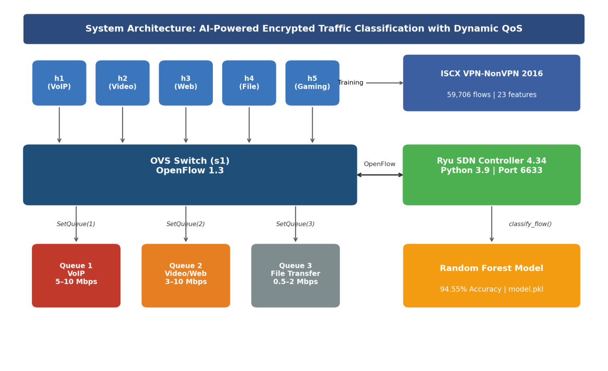
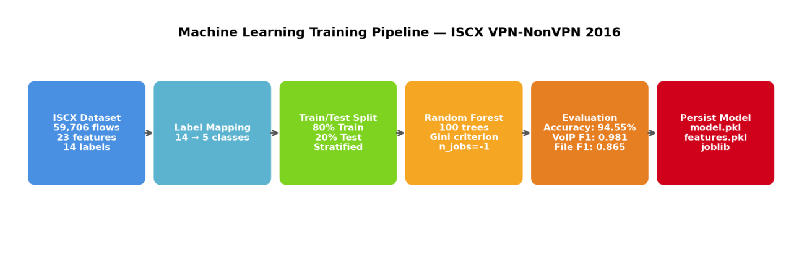
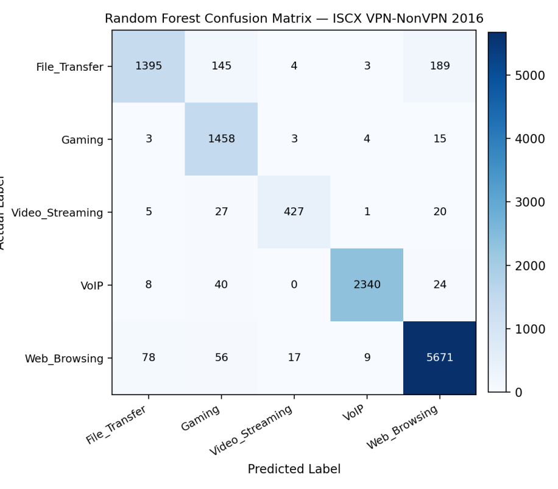
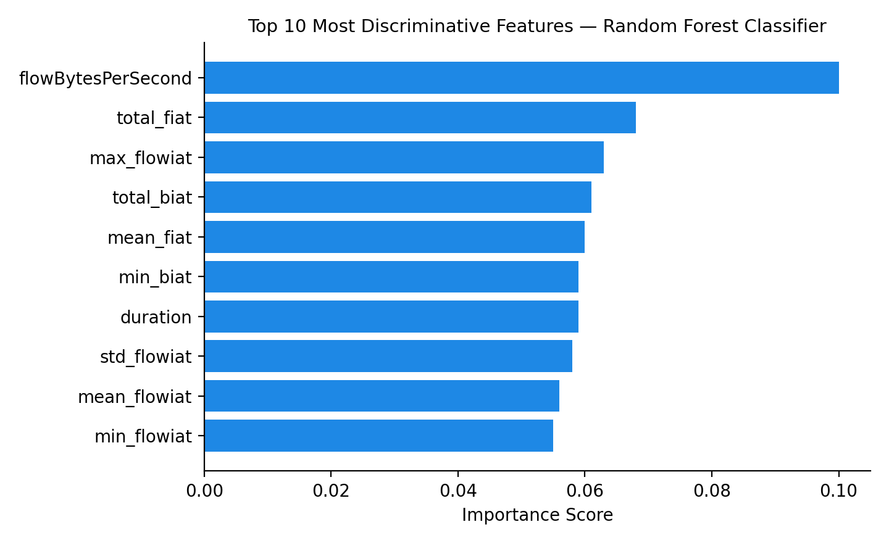
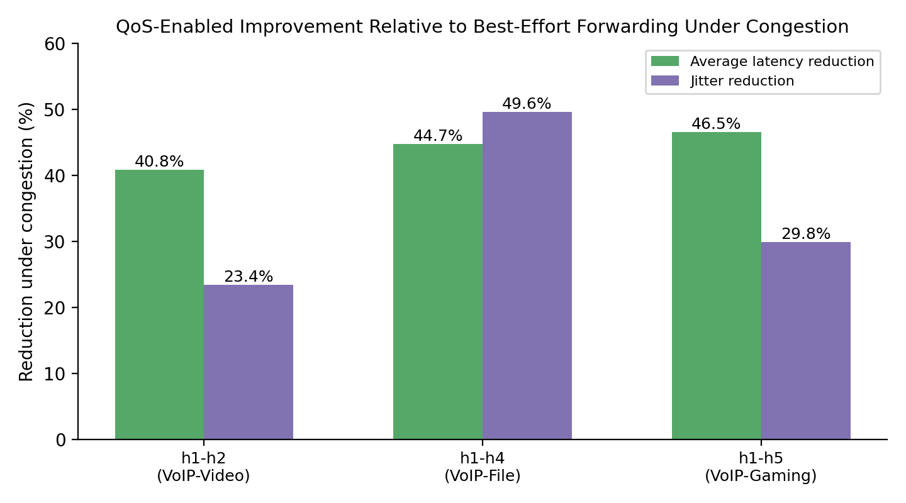
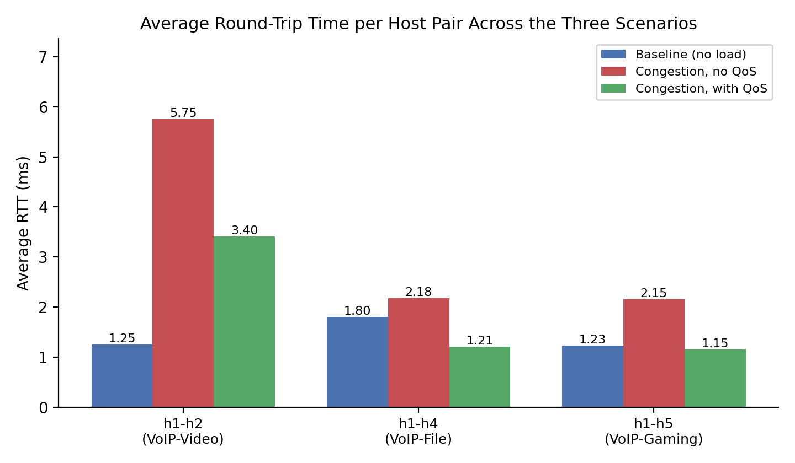
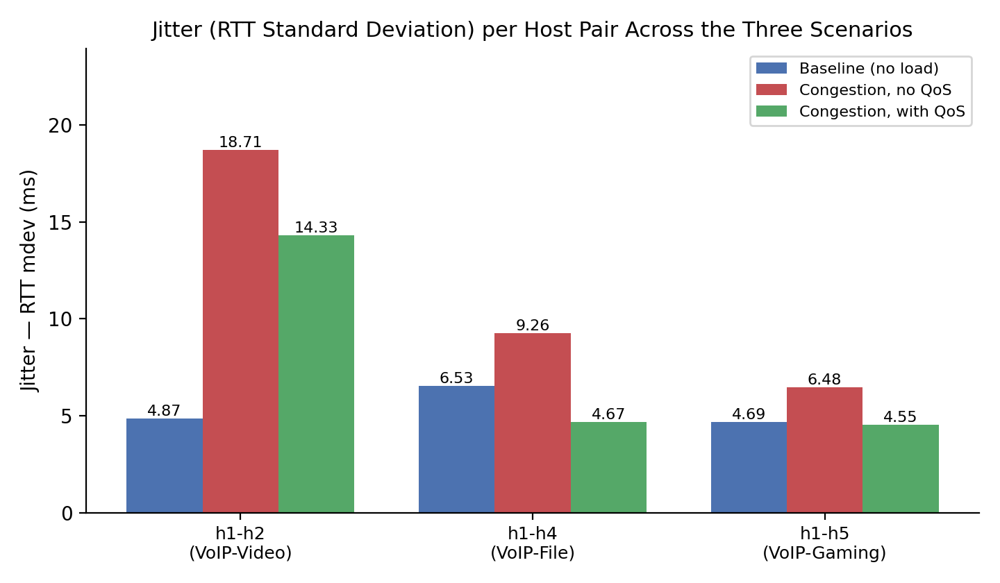

# AI-Powered Encrypted Traffic Classification with Dynamic QoS in SDN

A software-defined network that **identifies the application type of encrypted traffic without inspecting any payload**. It then gives each flow its own quality-of-service queue in real time.

- A Random Forest classifier is trained on flow-level timing and rate features of the ISCX VPN-NonVPN 2016 dataset.
- It is embedded in a Ryu SDN controller.
- After classification, the controller installs OpenFlow 1.3 rules that steer each flow into a Linux HTB queue on Open vSwitch.

**Highlights**

| | |
|---|---|
| Classification accuracy | **94.55%** on 11,942 test flows (5 classes) |
| Payload inspection | **None** — 23 flow-level features only |
| Average latency under congestion | **−40.8% to −46.5%** with QoS vs. best effort |
| Jitter under congestion | **−23.4% to −49.6%** |
| Packet loss | 0% in all nine trials |

Bachelor graduation project (graded 95/100), B.Sc. Technology of Networks and Mobiles, Al-Aqsa University, 2026.

---

## Architecture



The system has three layers:

1. **Data plane:** Mininet 2.3 hosts connected to an Open vSwitch bridge (`s1`) running OpenFlow 1.3. HTB queues are configured on `s1-eth1`.
2. **Control plane:** a Ryu 4.34 controller (`src/ryu_qos_controller.py`) acting as a learning switch with per-flow packet and byte counters.
3. **Intelligence:** a Random Forest (`model.pkl`) called by the controller for every tenth packet of a flow.

| Class | Queue | Guaranteed / max rate |
|---|---|---|
| VoIP | Q1 | 5 – 10 Mbps |
| Video streaming, Web browsing, Gaming | Q2 | 3 – 10 Mbps |
| File transfer | Q3 | 0.5 – 2 Mbps |

**How a packet moves through the system**

1. The first packet of a new flow reaches the switch, matches the permanent table-miss rule, and is sent to the controller as a Packet-In.
2. The controller learns MAC-to-port, updates the flow counters, and forwards the packet (Packet-Out).
3. On every tenth packet, the controller builds the feature vector and calls `model.predict()`. It maps the predicted class to a queue and installs an `OFPFlowMod` with `OFPActionSetQueue` (idle 30 s, hard 120 s).
4. Later packets take the fast path through the assigned HTB queue. When the rule expires, the flow is re-classified.

## Machine learning



**Training setup**
- **Data:** ISCX VPN-NonVPN 2016 — 59,706 flows, 23 time-related features, 14 original labels mapped to 5 classes.
- **Model:** Random Forest, 100 trees, Gini impurity.
- **Split:** stratified 80/20 (47,764 train / 11,942 test), `random_state=42`.

**Per-class results**

| Class | Precision | Recall | F1 | Support |
|---|---|---|---|---|
| VoIP | 0.99 | 0.97 | 0.98 | 2,412 |
| Web_Browsing | 0.96 | 0.97 | 0.97 | 5,831 |
| Video_Streaming | 0.95 | 0.89 | 0.92 | 480 |
| Gaming | 0.84 | 0.98 | 0.91 | 1,483 |
| File_Transfer | 0.94 | 0.80 | 0.87 | 1,736 |
| **Weighted avg** | **0.95** | **0.95** | **0.95** | **11,942** |

| Confusion matrix | Top features |
|---|---|
|  |  |

`flowBytesPerSecond` is the most discriminative feature. Throughput-level behaviour separates application types even under full TLS encryption.

**Live features.** OpenFlow counters provide three of the 23 training features at run time: `duration`, `flowPktsPerSecond` and `flowBytesPerSecond`. These are also the three most important features of the model. The controller places them at their training-time positions in a zero-initialised vector.

## QoS evaluation

The topology is one OVS bridge with five hosts:

| Host | Role |
|---|---|
| h1 | VoIP |
| h2 | Video |
| h3 | Web |
| h4 | File transfer |
| h5 | Gaming |

In every scenario, h1 sends 30 ICMP probes to h2, h4 and h5.

| Scenario | Background load | QoS |
|---|---|---|
| A — Baseline | none | off |
| B — Congestion | iperf TCP stream h3 → h4, 35 s | off |
| C — Congestion + QoS | same load | HTB queues and classifier active |

| Host pair | Scenario | Avg RTT (ms) | Max RTT (ms) | Jitter / mdev (ms) | Loss |
|---|---|---|---|---|---|
| h1 ↔ h2 | A | 1.247 | 27.238 | 4.868 | 0% |
| | B | 5.754 | 82.704 | 18.714 | 0% |
| | **C** | **3.405** | **80.070** | **14.329** | 0% |
| h1 ↔ h4 | A | 1.804 | 26.880 | 6.534 | 0% |
| | B | 2.180 | 51.901 | 9.260 | 0% |
| | **C** | **1.205** | **26.119** | **4.665** | 0% |
| h1 ↔ h5 | A | 1.225 | 26.210 | 4.688 | 0% |
| | B | 2.153 | 26.878 | 6.479 | 0% |
| | **C** | **1.151** | **25.447** | **4.546** | 0% |



| Average RTT | Jitter |
|---|---|
|  |  |

The raw `ping` output for every trial is in [`results/raw_results.md`](results/raw_results.md).

**Engineering note (defect DF-01).** During integration testing, hosts became unreachable after about two minutes. The cause was that the table-miss entry carried the same 120 s hard timeout as the per-flow rules. When it expired, the switch stopped sending unmatched packets to the controller. The fix makes the table-miss rule permanent (`idle_timeout=0, hard_timeout=0`), while per-flow rules keep their timeouts so flows are re-classified periodically.

---

## Reproducing the experiments

Tested on Ubuntu 22.04 (VMware, 4 vCPU, 8 GB RAM) with Mininet 2.3.0, Ryu 4.34 on Python 3.9, and scikit-learn 1.6.1.

```bash
# 1. Environment (Python 3.9 is mandatory for Ryu 4.34)
sudo add-apt-repository ppa:deadsnakes/ppa && sudo apt update
sudo apt install python3.9 python3.9-distutils python3.9-venv mininet -y
python3.9 -m venv venv && source venv/bin/activate
pip install -r requirements.txt

# 2. Dataset and model (see dataset/README.md)
python3.9 src/train_model.py          # -> Accuracy: 94.55%, writes model/*.pkl

# 3. Terminal 1 — controller
python3.9 -m ryu.cmd.manager src/ryu_qos_controller.py

# 4. Terminal 2 — topology with QoS (Scenario C) or without (A/B)
sudo python3 src/mininet_simple.py
sudo python3 src/mininet_noqos.py
```

Inside the Mininet CLI:

```
mininet> h4 iperf -s &
mininet> h3 iperf -c 10.0.0.4 -t 35 &
mininet> h1 ping h2 -c 30
```

Run `sudo mn -c` between scenarios. `scripts/` contains the stand-alone QoS setup and cleanup commands.

| Symptom | Fix |
|---|---|
| Hosts unreachable after ~2 minutes | Use this controller version (permanent table-miss rule) |
| `InconsistentVersionWarning` on start-up | Re-run `train_model.py` inside the controller's venv |
| `pingAll` fails right after QoS setup | Keep the ping-before-QoS order in `mininet_simple.py` |
| `Address already in use` on 6633 | `pkill -f ryu.cmd.manager`, then restart |

## Repository layout

```
src/
  train_model.py          Random Forest training -> model/model.pkl, features.pkl
  ryu_qos_controller.py   Ryu app: learning switch + ML classification + SetQueue
  mininet_simple.py       Topology with HTB queues (Scenario C)
  mininet_noqos.py        Same topology without queues (Scenarios A/B)
scripts/                  ovs-vsctl QoS setup and cleanup
results/raw_results.md    Unedited ping/iperf output of all trials
docs/figures/             Architecture, ML and QoS charts
dataset/, model/          Placeholders (data and trained model are not committed)
```

## Future work

- **Larger topologies.** Extend the evaluation to multi-switch topologies with real application traffic.
- **Richer live features.** Export inter-arrival statistics through sFlow/IPFIX so the deployed model can use its full 23-feature set.
- **Robustness.** Study how encrypted-traffic classifiers generalise across datasets and how they withstand adversarial traffic shaping.

## Author

**Mohammed Alisawi** · B.Sc. Technology of Networks and Mobiles, Al-Aqsa University
moalisawi16@gmail.com

## License

[MIT](LICENSE)
